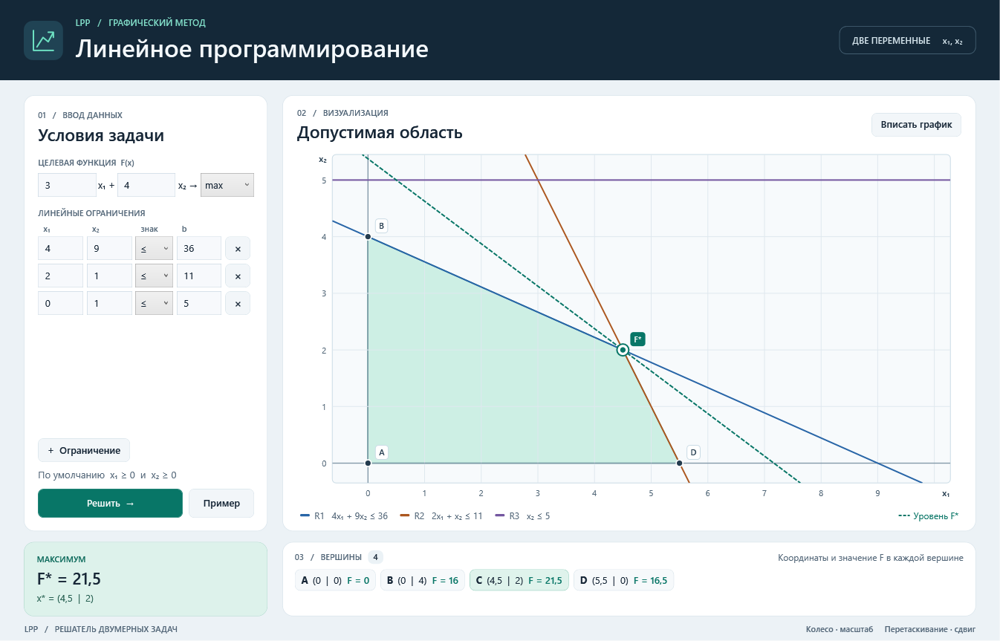
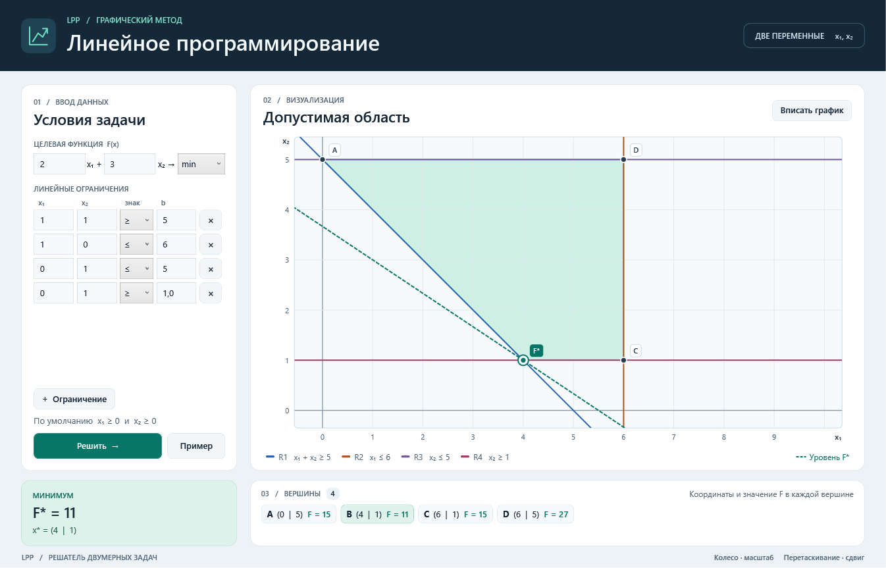

# LPP · Линейное программирование

Приложение для Windows решает задачи с двумя переменными графическим методом. Введите целевую функцию и ограничения, чтобы увидеть допустимую область, её вершины и значение функции в каждой из них.



## Запуск

Нужны Windows и [.NET 10 SDK](https://dotnet.microsoft.com/download/dotnet/10.0). Проект использует WPF и собирается без сторонних пакетов NuGet.

```powershell
dotnet build lpp.sln -c Release
dotnet run --project lpp.csproj -c Release --no-build
```

1. Введите коэффициенты функции **F = c₁x₁ + c₂x₂** и выберите **max** или **min**.
2. Добавьте ограничения вида **a₁x₁ + a₂x₂ ≤ b**, **≥ b** или **= b**. Приложение всегда учитывает **x₁ ≥ 0** и **x₂ ≥ 0**. Дробные числа можно вводить с точкой или запятой.
3. Нажмите **Решить**. Бирюзовая заливка показывает допустимую область, пунктир — линию уровня в оптимуме. Колесо мыши меняет масштаб, перетаскивание сдвигает график. Кнопка **Вписать график** возвращает исходный масштаб, **Пример** восстанавливает условия из примера.

## Контрольные задачи

**Максимум.** Встроенный пример решает **max F = 3x₁ + 4x₂** при ограничениях **4x₁ + 9x₂ ≤ 36**, **2x₁ + x₂ ≤ 11** и **x₂ ≤ 5**. Из второго активного ограничения получаем **x₂ = 11 − 2x₁**. Подстановка в первое даёт **x₁ = 4,5**, **x₂ = 2**. Значения функции в вершинах равны **0**, **16**, **21,5** и **16,5**, поэтому максимум равен **21,5**.

**Минимум.** При **x₁ + x₂ ≥ 5**, **x₁ ≤ 6** и **1 ≤ x₂ ≤ 5** функция **F = 2x₁ + 3x₂** минимальна в точке **(4; 1)** и равна **11**.



## Как работает решатель

- [Solver](Solver/) переводит ограничения в полуплоскости. Для каждой граничной прямой он вычисляет допустимый интервал одной координаты и берёт конечные концы этого интервала. Так находятся вершины за **O(n²)** в худшем случае, где **n** — число ограничений.
- Если вершин нет, задача несовместна. Если из допустимой точки можно двигаться по лучу, улучшая значение функции, оптимум неограничен. Иначе решатель выбирает лучшую вершину и отмечает случаи с несколькими оптимальными точками.
- [Views](Views/) рисует прямые в форме **a₁x₁ + a₂x₂ = b** и линию уровня **c₁x₁ + c₂x₂ = F***. График использует готовое решение и при смене масштаба пересчитывает только видимую геометрию. Вертикальные и горизонтальные прямые используют тот же алгоритм.
- Расчёты идут в двойной точности с относительным допуском. Интерфейс принимает ноль и ненулевые коэффициенты с модулем от **10⁻⁹** до **10⁹**. Почти совпадающие ограничения и вершины чувствительны к округлению.

## Проверки и производительность

```powershell
dotnet run --project Tests/lpp.Tests.csproj -c Release
dotnet run --project Tests/lpp.Tests.csproj -c Release -- --benchmark
```

Проверки включают осевые и параллельные прямые, равенства, вырожденные области, несовместные и неограниченные задачи, а также 2 000 задач, сверенных с независимым перебором пересечений на целых числах.

На задаче с 256 ограничениями и 256 вершинами бенчмарк сравнивает решатель с перебором пар прямых и последующей проверкой каждого пересечения. Он сверяет оптимум и число вершин, прогревает оба алгоритма и выводит медиану 21 запуска в Release.

В локальном замере под Windows с .NET 10 решатель занял **0,638 мс**, перебор — **1,024 мс**. Время зависит от машины и набора ограничений.
